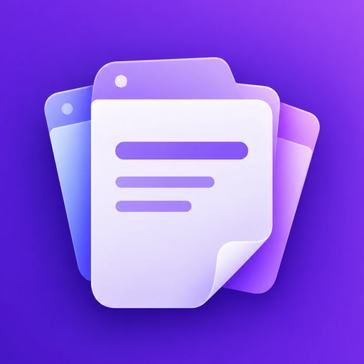
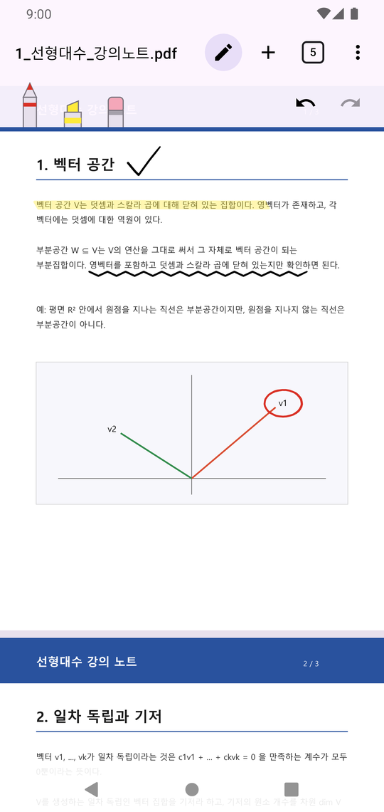
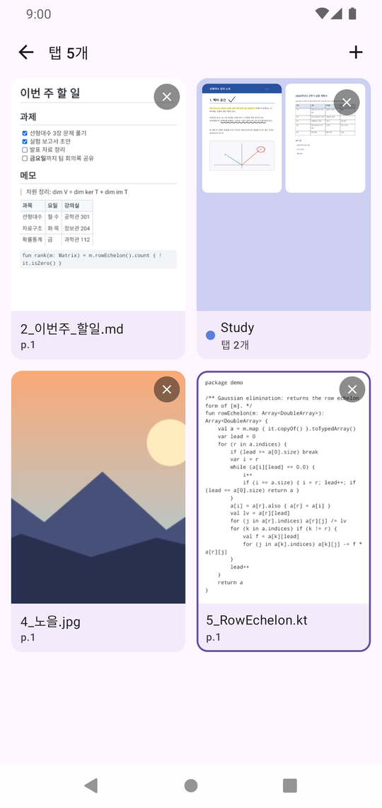
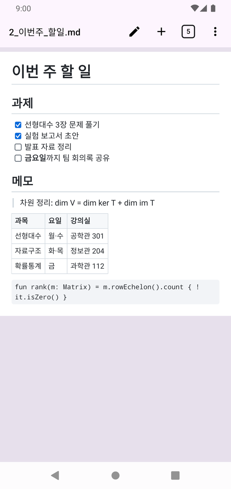
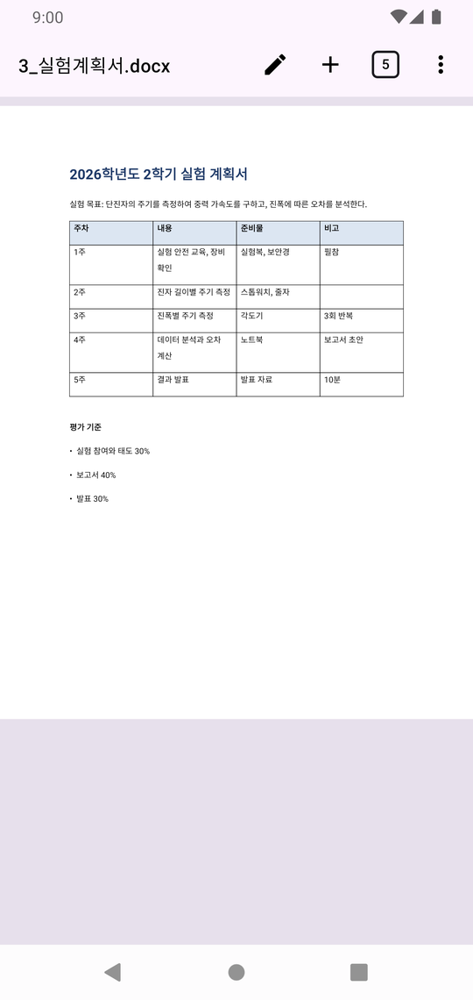

#  EveryViewer


-3DDC84?logo=android&logoColor=white)


**PDF·문서·전자책·웹 페이지·이미지·텍스트를 브라우저처럼 탭으로 열어두고, 좌우로 밀어 넘기며 보고, 그 위에 필기하는 Android 뷰어.**

여러 문서를 번갈아 봐야 할 때(교재와 해설지, 논문 여러 편, 회의 자료와 메모) 파일 목록으로 돌아가 다시 열 필요가 없습니다. 앱을 꺼도 탭·그룹·읽던 위치·필기가 그대로 남습니다.

<p align="center">
  
  
  
  
</p>

## 주요 기능

- **탭으로 열기** — 파일 여러 개를 한 번에 열어 탭으로 둡니다. 다른 앱의 "열기·공유"로 받은 파일과 글도 탭이 됩니다.
- **좌우 스와이프로 탭 넘기기** — 사진 갤러리처럼 화면을 밀어 이전·다음 탭으로 넘어갑니다. 확대한 상태에서는 페이지 끝에 닿은 뒤 한 번 더 밀어야 넘어갑니다.
- **탭 그룹** — 과목·프로젝트별로 탭을 묶습니다. 스와이프는 지금 그룹 안에서 넘어가고, 설정에서 그룹 끝에서 다음 그룹으로 이어 넘기게 할 수 있습니다.
- **파일 묶음** — 여러 파일을 열 때 하나로 묶으면 한 탭에서 쪽이 이어지는 한 문서처럼 봅니다(형식을 섞어도 됨). 묶음 편집 화면에서 순서를 바꾸고 빼거나 더합니다.
- **그대로 복원** — 앱을 완전히 꺼도 탭 순서, 그룹, 탭마다의 페이지·확대율·스크롤 위치, 필기가 돌아옵니다.
- **필기** — 펜(필압), 형광펜, 획 지우개, 되돌리기. 필기는 탭마다 앱 안에 저장하고 원본 파일은 건드리지 않습니다.
  - `✎` 버튼을 눌러야 그려지므로, 평소에는 펜도 손가락처럼 스크롤만 합니다.
  - 펜이 있는 기기에서는 펜만 그리고 손가락은 스크롤합니다. 펜을 넣어 두었을 때는 도구 막대의 손가락 버튼으로 손가락 필기를 켜고, 펜을 다시 대면 저절로 돌아갑니다. 펜 측면 버튼을 누른 채 그리면 지우개가 됩니다.
- **텍스트 검색** — 문서 안에서 단어를 찾아 칠하고 차례로 옮겨 다닙니다. PDF는 Android 12 이상(시스템 업데이트 필요)·15 이상에서 됩니다.
- **텍스트 선택·복사** — 길게 눌러 단어를 고르고 손잡이로 범위를 넓혀 복사하거나 공유합니다.
- **목차** — PDF 북마크, 전자책 목차, Word·한글 개요, 마크다운·HTML 제목, 슬라이드 제목, 시트 이름을 왼쪽 서랍에서 보고 그 자리로 갑니다.
- **PDF로 내보내기** — 어떤 탭이든 필기를 넣은 PDF로 저장하거나 공유합니다. PDF는 원본 뒤에 필기만 덧붙여 글자·링크·목차가 그대로 남고, 문서 형식은 글자가 글자로 남습니다.
- **링크** — 문서 속 웹 링크는 브라우저로 열고, PDF의 목차 링크는 그 쪽으로 이동합니다 (PDF는 검색과 같은 Android 버전에서).
- **형식과 상관없이 같은 화면** — 모든 파일을 세로로 이어지는 페이지로 보여 줍니다.
- **오프라인 전용** — 인터넷 권한이 없고, 어떤 데이터도 밖으로 보내지 않습니다. Android 백업(Google 드라이브·기기 이전)에는 탭 구성·필기·설정만 포함되고, 앱 안에 복사해 둔 문서는 빠집니다.

## 지원 형식

| 형식 | 확장자 | 비고 |
|---|---|---|
| PDF | pdf | Android 기본 렌더러. 암호 PDF는 열 때 암호를 물음 (Android 12+ 시스템 업데이트·15+, 암호는 저장하지 않음) |
| 텍스트 | txt, log, csv, json, xml, 소스 코드 등 | 인코딩 자동 판별 (UTF-8, EUC-KR/CP949 등). 크기 제한 없이 앞부분부터 바로 표시 |
| 마크다운 | md, markdown | 항상 렌더링된 모습으로 표시 (표, 체크박스, 코드 블록, 링크) |
| HTML | html, htm, xhtml | 앱이 직접 그림: 태그 모양과 간단한 CSS(색·글자·여백·테두리·표). 스크립트 실행 없음, 인터넷에서 아무것도 받지 않음 |
| 전자책 | epub | 장을 읽는 순서대로 HTML처럼 이어서 표시, 책의 CSS·그림 반영. DRM 책 제외 |
| 이미지 | jpg, png, webp, gif, bmp, heic | 사진 회전 정보 반영 |
| Word | docx | 문단·글자 모양, 표(병합·테두리·음영), 그림, 머리글/바닥글 |
| 한글 | hwpx, hwp | docx와 같은 범위 + 장평·자간, 줄 간격 %. hwp는 hwplib로 읽어 hwpx와 똑같이 그림 |
| Excel | xlsx, xlsm | 시트마다 사용한 범위를 원래 열 너비·행 높이로. 셀 서식(글꼴·채우기·테두리·맞춤·줄 바꿈), 숫자·날짜 표시 형식, 병합, 넘치는 글, 링크, 그림 |
| PowerPoint | pptx | 슬라이드 한 장 = 한 페이지. 글상자, 도형, 연결선, 그림, 표, 레이아웃·마스터 |

오피스 문서(docx·hwpx·hwp·pptx·xlsx)는 용지·슬라이드·시트 크기 그대로 그립니다(hwp는 hwplib로 읽고, 나머지는 직접 해석). HTML·epub은 브라우저 엔진 없이 직접 해석해 휴대폰 폭으로 이어 그립니다. 원본과 크게 틀어지지 않는 수준이 목표이며, 차트·수식·SmartArt처럼 지원하지 않는 개체는 자리만 표시합니다. 자세한 범위는 [기획서 5.7](docs/기획서.md#57-지원-형식-확장)에 있습니다.

## 설치

아직 공개 배포 전입니다. 소스에서 직접 빌드해 설치합니다.

### 요구 사항

- Android 8.0 (API 26) 이상 기기 또는 에뮬레이터
- JDK 17
- Android SDK (API 37) — 경로는 `local.properties`의 `sdk.dir`에 적습니다

### 빌드

```bash
./gradlew assembleDebug        # 디버그 APK 빌드
./gradlew installDebug         # 연결된 기기에 설치
./gradlew connectedDebugAndroidTest   # 계측 테스트 (기기 필요, 끝나면 앱을 지움)
```

Windows에서는 `gradlew.bat`을 씁니다.

## 기술 스택

| 영역 | 사용 |
|---|---|
| 언어·UI | Kotlin, Jetpack Compose (Material 3) |
| PDF | Android `PdfRenderer` |
| 필기 | [Jetpack Ink](https://developer.android.com/jetpack/androidx/releases/ink) (저지연 획 그리기, 브러시, 직렬화) |
| 마크다운 | [commonmark-java](https://github.com/commonmark/commonmark-java) + GFM 확장 |
| HTML | [jsoup](https://jsoup.org/)으로 해석, CSS·조판은 직접 (docx와 같은 조판) |
| hwp | [hwplib](https://github.com/neolord0/hwplib) (Apache-2.0)로 읽고 hwpx와 같은 모델·조판 |
| 인코딩 판별 | [juniversalchardet](https://github.com/albfernandez/juniversalchardet) |
| docx·hwpx·pptx·xlsx | 직접 해석 (zip + XmlPullParser) → 문서·슬라이드 모델 → 용지·슬라이드 단위 조판 |
| 저장 | Room |
| 파일 접근 | Storage Access Framework (영구 URI 권한) |

## 프로젝트 구조

```
app/src/main/java/com/tabpdf/
  doc/          형식 판별, 형식별 문서(텍스트·마크다운·이미지), 조판·페이지 나누기, 썸네일
  doc/office/   docx·hwpx·pptx·xlsx 해석과 조판
  doc/html/     HTML 해석, CSS 적용, epub
  pdf/          PdfRenderer 래퍼
  ink/          필기 도구·저장·입력 규칙
  tabs/         탭·그룹 구조, ViewModel, 파일 접근
  ui/           뷰어, 탭 전환 화면, 그룹 패널, 필기 도구 막대
  data/         Room DB
```

앱 식별자는 `io.github.itic1721.everyviewer`입니다(0.13.0까지는 `com.tabpdf`). 코드의 패키지 `com.tabpdf`는 예전 이름(TabPDF)에서 왔습니다.

## 문서

- [기획서](docs/기획서.md) — 기능·UX 결정, 제스처 규칙, 데이터 모델, 성능 목표, 개발 단계와 이후 계획
- [CLAUDE.md](CLAUDE.md) — 빌드·테스트 방법과 구현 원칙 (개발용)

## 라이선스

Apache License 2.0으로 배포합니다. 전문은 [LICENSE](LICENSE)에 있습니다.

함께 쓰는 라이브러리와 라이선스: Kotlin·kotlinx.coroutines·AndroidX(Jetpack Compose, Room, Ink 등)·[hwplib](https://github.com/neolord0/hwplib) — Apache-2.0, [jsoup](https://jsoup.org/) — MIT, [commonmark-java](https://github.com/commonmark/commonmark-java) — BSD 2-Clause, [juniversalchardet](https://github.com/albfernandez/juniversalchardet) — MPL 1.1.
