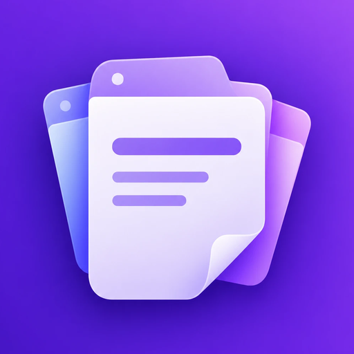
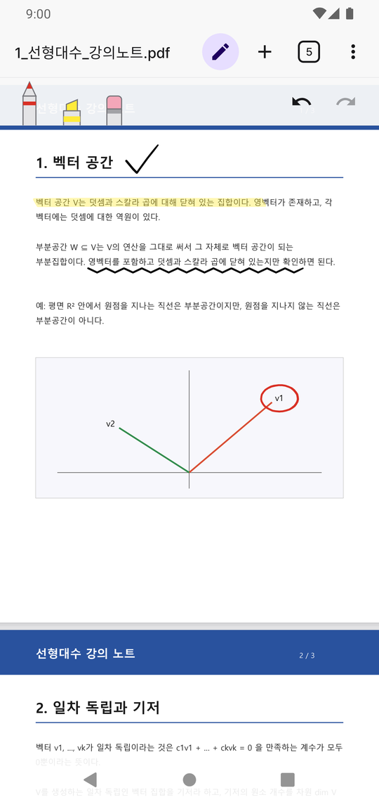
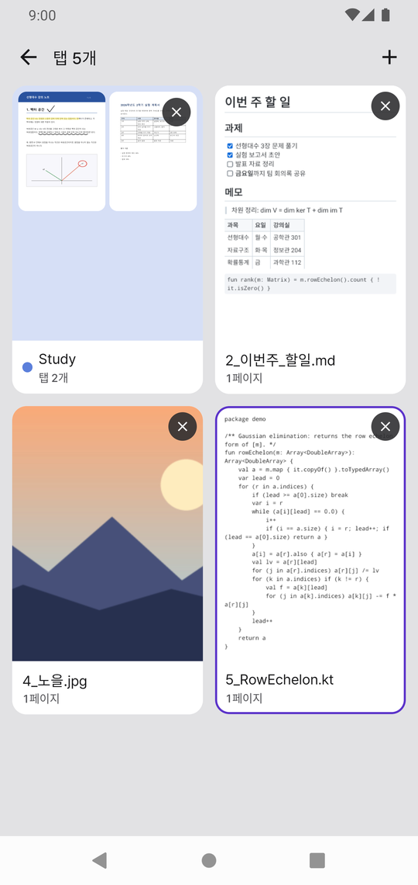
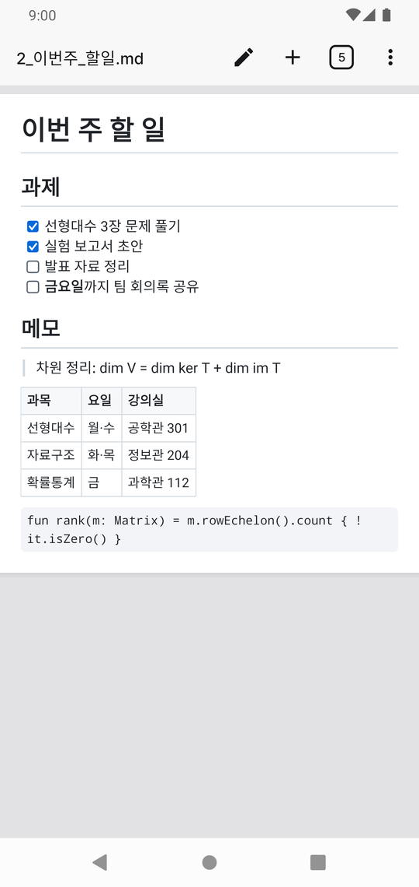
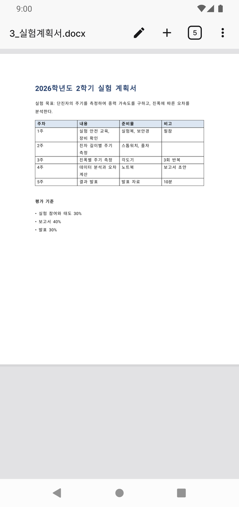

#  EveryViewer


-3DDC84?logo=android&logoColor=white)


Android용 문서 뷰어입니다. 파일을 브라우저 탭처럼 열어 두고, 화면을 좌우로 밀어 다른 파일로 넘어가고, 그 위에 펜으로 필기합니다. PDF, Word, 한글, PowerPoint, Excel, epub, HTML, 마크다운, 텍스트, 이미지를 열 수 있습니다.

교재와 해설지, 논문 여러 편처럼 여러 파일을 오가며 볼 때 매번 파일 목록으로 돌아가지 않아도 됩니다. 앱을 껐다 켜도 열어 둔 탭과 마지막으로 보던 페이지, 필기가 그대로 있습니다.

<p align="center">
  
  
  
  
</p>

## 기능

### 탭과 그룹

여러 파일을 한 번에 열면 파일마다 탭이 하나씩 생깁니다. 다른 앱에서 "열기"나 "공유"로 보낸 파일과 글도 탭으로 열립니다. 화면을 좌우로 밀면 이전·다음 탭으로 넘어갑니다. 확대한 상태에서는 페이지 끝에 닿은 뒤 한 번 더 밀어야 넘어가므로, 확대한 페이지를 둘러보다가 탭이 바뀌지는 않습니다.

탭은 과목이나 프로젝트별로 그룹에 묶어 둡니다. 스와이프는 지금 그룹 안에서만 넘어가고, 설정을 바꾸면 그룹 끝에서 다음 그룹으로 이어집니다. 여러 파일을 하나로 묶어 한 탭에서 이어진 문서처럼 볼 수도 있습니다. 형식이 달라도 묶을 수 있고, 묶은 뒤에 순서를 바꾸거나 파일을 빼고 더할 수 있습니다.

앱을 완전히 꺼도 탭 순서와 그룹, 탭마다 보던 페이지·확대율·스크롤 위치가 남습니다.

### 필기

펜(필압), 형광펜, 획 지우개, 되돌리기가 있습니다. 필기는 앱 안에 탭별로 저장하고 원본 파일은 고치지 않습니다.

`✎` 버튼을 눌렀을 때만 그려지므로 평소에는 펜을 대도 스크롤만 됩니다. 펜을 쓰는 기기에서는 펜으로 그리고 손가락으로 스크롤합니다. 펜을 넣어 두고 손가락으로 그리려면 도구 막대의 손가락 버튼을 켭니다. 펜을 다시 대면 원래대로 돌아갑니다. 펜 측면 버튼을 누른 채 그으면 지워집니다.

### 읽기

- 검색: 문서에서 단어를 찾아 칠하고 하나씩 옮겨 갑니다.
- 선택·복사: 길게 눌러 단어를 고르고, 손잡이를 끌어 범위를 넓힌 뒤 복사하거나 공유합니다.
- 목차: PDF 북마크, epub 목차, Word·한글 개요, 마크다운·HTML 제목, 슬라이드 제목, Excel 시트 이름을 왼쪽 서랍에서 골라 그 자리로 갑니다.
- 링크: 웹 주소는 브라우저로 열고, PDF 안에서 다른 페이지를 가리키는 링크는 그 페이지로 이동합니다.

PDF의 검색·선택·링크는 Android 15 이상, 또는 시스템 업데이트를 받은 Android 12~14에서만 됩니다.

### PDF로 내보내기

어느 탭이든 필기를 넣은 PDF로 저장하거나 공유합니다. PDF 파일은 원본 뒤에 필기만 덧붙이므로 글자·링크·목차가 원본 그대로입니다. 문서 형식은 글자가 그림이 아닌 글자로 들어가고, 이미지와 파일 묶음은 페이지마다 그림으로 들어갑니다.

### 인터넷 권한 없음

앱에 인터넷 권한이 없어서 데이터가 밖으로 나가지 않습니다. Android 백업(Google 드라이브, 기기 이전)에는 탭 구성·필기·설정만 들어가고, 앱 안에 복사해 둔 문서는 빠집니다.

## 지원 형식

| 형식 | 확장자 | 비고 |
|---|---|---|
| PDF | pdf | Android 기본 렌더러. 암호 PDF는 열 때 암호를 묻고, 암호는 저장하지 않음 (Android 12~14 시스템 업데이트 또는 15 이상) |
| 텍스트 | txt, log, csv, json, xml, 소스 코드 등 | 인코딩 자동 판별(UTF-8, EUC-KR/CP949 등). 큰 파일도 앞부분부터 바로 표시 |
| 마크다운 | md, markdown | 렌더링한 모습으로만 표시(표, 체크박스, 코드 블록, 링크) |
| HTML | html, htm, xhtml | 태그 모양과 간단한 CSS(색, 글자, 여백, 테두리, 표). 스크립트는 실행하지 않고 인터넷에서 아무것도 받지 않음 |
| 전자책 | epub | 장을 읽는 순서대로 이어서 표시, 책의 CSS와 그림 반영. DRM이 걸린 책은 열 수 없음 |
| 이미지 | jpg, png, webp, gif, bmp, heic | 사진의 회전 정보 반영 |
| Word | docx | 문단·글자 모양, 표(병합, 테두리, 음영), 그림, 머리글·바닥글 |
| 한글 | hwpx, hwp | docx와 같은 범위에 장평·자간, 줄 간격 % |
| Excel | xlsx, xlsm | 시트마다 쓴 범위를 원래 열 너비·행 높이로. 셀 서식(글꼴, 채우기, 테두리, 맞춤, 줄 바꿈), 숫자·날짜 표시 형식, 병합, 넘치는 글, 링크, 그림 |
| PowerPoint | pptx | 슬라이드 한 장이 한 페이지. 글상자, 도형, 연결선, 그림, 표, 레이아웃·마스터 |

어떤 형식이든 세로로 이어지는 페이지로 보여 줍니다. 오피스 문서는 원래 용지·슬라이드·시트 크기대로 그리고, HTML과 epub은 휴대폰 폭에 맞춰 이어 그립니다. 브라우저 엔진이나 오피스 라이브러리 없이 앱이 직접 해석합니다(hwp만 hwplib로 읽은 뒤 hwpx와 같은 방식으로 그림). docx는 Word와 같은 자리에서 줄과 쪽이 바뀌도록 맞췄고, 다른 형식은 원본과 조금 다를 수 있습니다. 차트, 수식, SmartArt는 그리지 않고 자리만 표시합니다. 자세한 범위는 [기획서 5.7](docs/기획서.md#57-지원-형식-확장)에 있습니다.

## 설치

[GitHub Releases](https://github.com/iTIC1721/EveryViewer/releases)에서 APK를 받아 설치합니다. 지금은 개발 버전이라 사전 출시(pre-release)로 올립니다. 릴리스 노트 끝에 APK와 서명 인증서의 SHA-256이 있으니 받은 파일과 맞는지 확인할 수 있습니다.

### 직접 빌드

필요한 것:

- Android 8.0 (API 26) 이상 기기 또는 에뮬레이터
- JDK 17
- Android SDK (API 37). 경로는 `local.properties`의 `sdk.dir`에 적습니다.

```bash
./gradlew assembleDebug               # 디버그 APK 빌드
./gradlew installDebug                # 연결된 기기에 설치
./gradlew connectedDebugAndroidTest   # 계측 테스트 (기기 필요, 끝나면 앱을 지움)
```

Windows에서는 `gradlew.bat`을 씁니다.

## 기술 스택

| 영역 | 사용 |
|---|---|
| 언어·UI | Kotlin, Jetpack Compose (Material 3) |
| UI 글꼴 | [Pretendard](https://github.com/orioncactus/pretendard) Std |
| PDF | Android `PdfRenderer`. 권한 없는 격리 프로세스에서 실행 |
| 필기 | [Jetpack Ink](https://developer.android.com/jetpack/androidx/releases/ink) |
| 마크다운 | [commonmark-java](https://github.com/commonmark/commonmark-java)와 GFM 확장 |
| HTML | [jsoup](https://jsoup.org/)으로 해석, CSS 적용과 조판은 직접 (docx와 같은 조판) |
| hwp | [hwplib](https://github.com/neolord0/hwplib)로 읽은 뒤 hwpx와 같은 모델·조판 |
| 인코딩 판별 | [juniversalchardet](https://github.com/albfernandez/juniversalchardet) |
| docx·hwpx·pptx·xlsx | 직접 해석 (zip, XmlPullParser) → 문서·슬라이드 모델 → 용지·슬라이드 단위 조판 |
| 저장 | Room |
| 파일 접근 | Storage Access Framework (영구 URI 권한) |

## 프로젝트 구조

```
app/src/main/java/com/tabpdf/
  doc/          형식 판별, 텍스트·마크다운·이미지 문서, 조판·페이지 나누기, 썸네일
  doc/office/   docx·hwpx·hwp·pptx·xlsx 해석과 조판
  doc/html/     HTML 해석, CSS 적용, epub
  pdf/          PdfRenderer 래퍼, PDF·그림 디코딩을 맡는 격리 프로세스
  export/       PDF로 내보내기
  ink/          필기 도구·저장·입력 규칙
  tabs/         탭·그룹 구조, ViewModel, 파일 접근
  ui/           뷰어, 탭 전환 화면, 그룹 패널, 필기 도구 막대, 테마
  data/         Room DB
```

앱 식별자는 `io.github.itic1721.everyviewer`입니다(0.13.0까지는 `com.tabpdf`). 코드 패키지 이름 `com.tabpdf`는 예전 가칭 TabPDF에서 왔습니다.

## 문서

- [기획서](docs/기획서.md): 기능·UX 결정, 제스처 규칙, 데이터 모델, 성능 목표, 개발 단계와 이후 계획
- [CLAUDE.md](CLAUDE.md): 빌드·테스트 방법과 구현 원칙 (개발용)

## 라이선스

Apache License 2.0. 전문은 [LICENSE](LICENSE)에 있습니다.

함께 쓰는 라이브러리와 글꼴의 라이선스:

- Apache-2.0: Kotlin, kotlinx.coroutines, AndroidX(Jetpack Compose, Room, Ink 등), [hwplib](https://github.com/neolord0/hwplib)
- MIT: [jsoup](https://jsoup.org/)
- BSD 2-Clause: [commonmark-java](https://github.com/commonmark/commonmark-java)
- MPL 1.1: [juniversalchardet](https://github.com/albfernandez/juniversalchardet)
- SIL Open Font License 1.1: [Pretendard](https://github.com/orioncactus/pretendard)
